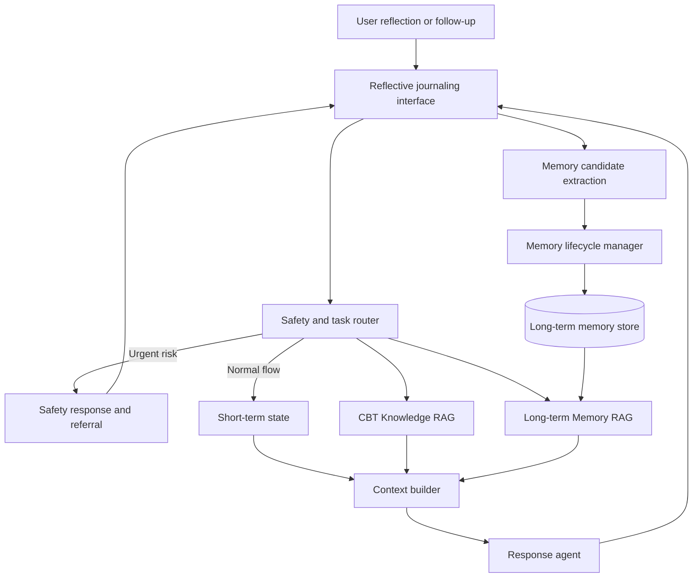

Research prototype for **A Hierarchical Memory Framework for Psychotherapy Reflection and Care Tracking**.

## Project overview

This project investigates how a CBT reflective-journaling agent can form, store, retrieve, update, correct and forget memories across repeated sessions. It is designed as a research and educational prototype, not as a diagnostic tool or a replacement for therapists.

The central research question is:

> Does correctable, expirable and deletable long-term memory support cross-session tracking more accurately than retrieval over the same raw conversation history?

Goals, homework and changing self-reports are the intended use cases.

## Overall architecture



The system uses two separate but coordinated retrieval channels:

- **CBT Knowledge RAG** retrieves professional CBT evidence, methods and safety guidance.
- **Long-term Memory RAG** retrieves relevant user-specific history, including emotions, goals, events, assignments, outcomes, cognitive patterns and corrections.

In the target architecture, deterministic safety routing runs before both retrieval channels. A production risk detector and referral workflow have not yet been implemented. Qualified knowledge and memory results are combined with the short-term session state by the context builder. Either retriever may return no context when its results are not sufficiently relevant.

The conversation also has a separate memory write path: supported information is extracted as a candidate, validated, versioned and managed through update, correction and forgetting rules before it becomes retrievable.

## Memory during a conversation

The default dialogue experience uses automatic history capture and
**checking at the point of use**, rather than asking the user to organize and
approve a list after every conversation. The strict review tools remain available.

| Available evidence | How it should be used |
| --- | --- |
| A source-verified user quotation | Refer to it as something the user said at that time; this does not prove it is still true |
| A changing goal, old preference or conflicting observation | Ask one relevant, optional question before relying on it as the current state |
| An unsupported model interpretation | Keep it out of factual context; a model's high confidence does not verify it |

For example, when discussing CBT practice: “You mentioned that thought records
sometimes made you more tense. Has that changed, or does the exercise still feel
burdensome?” The user can answer in ordinary conversation, correct the record or
move on. Silence is not confirmation. Questions should support the current task,
not become another checklist.

Evidence quality, freshness and conflicts are separate trust signals. Their
heuristics are not calibrated probabilities of truth. Automatic capture can be
turned off, and correction/deletion remain available. The first implementation
captures eligible quotations without an extra extraction-model call; it does
not silently validate semantic summaries or infer homework completion.

The repository's deterministic regression suite covers automatic
capture, historical/current-use separation, optional checks, source-tamper
rejection, opt-out handling and correction/deletion, plus source-bound study
capture, independent-review import and withdrawal-safe exports. These are software checks;
naturalness and reduced user effort still require a participant evaluation.

## Architecture components

| Component | Responsibility |
|---|---|
| Safety and task router | Detects urgent risk and decides whether knowledge or memory retrieval is required |
| Short-term memory | Maintains the recent conversation, current emotion, active goal, thought record and assignment |
| CBT Knowledge RAG | Retrieves grounded professional evidence and safety references |
| Long-term Memory RAG | Stores and retrieves user-specific, time-sensitive and correctable memories |
| Memory lifecycle manager | Handles consolidation, conflict, correction, superseding, expiry and deletion |
| Context builder | Validates, separates and budgets short-term state, personal memory and professional evidence |
| Response agent | Generates a supportive response while respecting safety and role boundaries |

See the [complete architecture document](docs/architecture.md) for the overall design and all module-level diagrams on one page.

## Repository structure

```text
cbt-memory-system/
├── docs/
│   └── architecture.md                 # Overall and module-level diagrams
├── modules/
│   ├── cbt-knowledge-rag/              # Professional knowledge and safety references
│   ├── long-term-memory/
│   │   ├── schema/                     # Typed memory records and metadata
│   │   ├── extraction/                 # Session-to-memory candidates
│   │   ├── storage/                    # User-scoped records and indexes
│   │   ├── retrieval/                  # Query, search, reranking and gating
│   │   └── lifecycle/                  # Update, correction, conflict and forgetting
│   └── agent-integration/              # Routing and context assembly
├── evaluation/
│   ├── knowledge-retrieval/
│   ├── memory-retrieval/
│   ├── end-to-end-dialogue/             # Frozen historical-QA experiment
│   ├── objective-memory/                # Public-gold comparison and control replay
│   └── safety/
└── app/                                # Colab dialogue/memory UI and synthetic CLI
```

## Implementation status

Memory Schema v1 and Memory Manager v1 are implemented, including provenance-aware extraction, SQLite storage, correction, conflict confirmation, expiry, deletion and user/sensitivity isolation. Model-extracted summaries remain unconfirmed candidates until a separately evidenced confirmation step. Lifecycle decisions and their audit events run in serialized transactions, stale correction targets are rejected, hard deletion remains final during concurrent expiry, and only one active version may occupy a memory slot. Long-term Memory RAG v1 and the Agent context builder provide relevance gating, temporal reranking, access filters, bounded personal/professional sections and accurate inclusion traces.

A Colab dialogue interface now connects the extraction contract, SQLite memory manager,
retriever and context builder. Its conversational mode automatically captures eligible
fictional user quotations and checks changing information when it becomes relevant.
Saved observations remain distinguishable from confirmed facts. Optional review mode
supports candidate revision, explicit confirmation, correction and deletion.
The default responder is an
offline software demonstration; an optional capped provider enables real model responses.
The small safety gate is a research safeguard, not a complete crisis service.
In the optional review panel, candidates can be revised before confirmation. The interface shows the actual
extraction window and warns before discarding unprocessed messages. Memory
references are readable and labeled as context supplied to the agent, not proof
of use. Deletion explains its chat-reset effect before a separate confirmation.

**Use hosted Colab for models, GPU work and full datasets.** The
[dialogue and frozen historical-QA notebook](app/Structured_Memory_Colab.ipynb)
and the [objective comparison notebook](evaluation/objective-memory/Objective_Memory_Comparison_Colab.ipynb)
have separate experiment directories and protocols. Production benchmark preparation and API adapters refuse ordinary local
execution. No local model download or personal-computer GPU is required.

## Research validation

Software implementation, public memory-task results, CBT process quality and
real-user outcomes are evaluated separately. CBT dialogue benefit and reduced
user burden remain pending independent professional review and human evaluation.

Experimental score tables, exploratory pilots and earlier implementation
checkpoints are available in the [research archive](RESEARCH_ARCHIVE.md).
The archive keeps the published records and their limitations together.

## Run the demo

Use the [hosted Colab dialogue and memory notebook](app/Structured_Memory_Colab.ipynb)
for the interface. Model/API work and full datasets require genuine hosted Colab.
The following software checks can run in an independent cloud Linux environment:

```bash
python -m pip install -r requirements-test.lock
python -m unittest discover -s tests -v
python app/memory_demo.py --scripted
```

The demo accepts the supplied fictional fixtures.

## Documentation

- [System architecture](docs/architecture.md)
- [Colab dialogue and memory demo](app/README.md)
- [Memory lifecycle implementation](modules/long-term-memory/README.md)
- [Source policy and evidence cards](modules/cbt-knowledge-rag/README.md)
- [Pinned development environment](docs/development.md)
- [Research archive and experimental limitations](RESEARCH_ARCHIVE.md)
