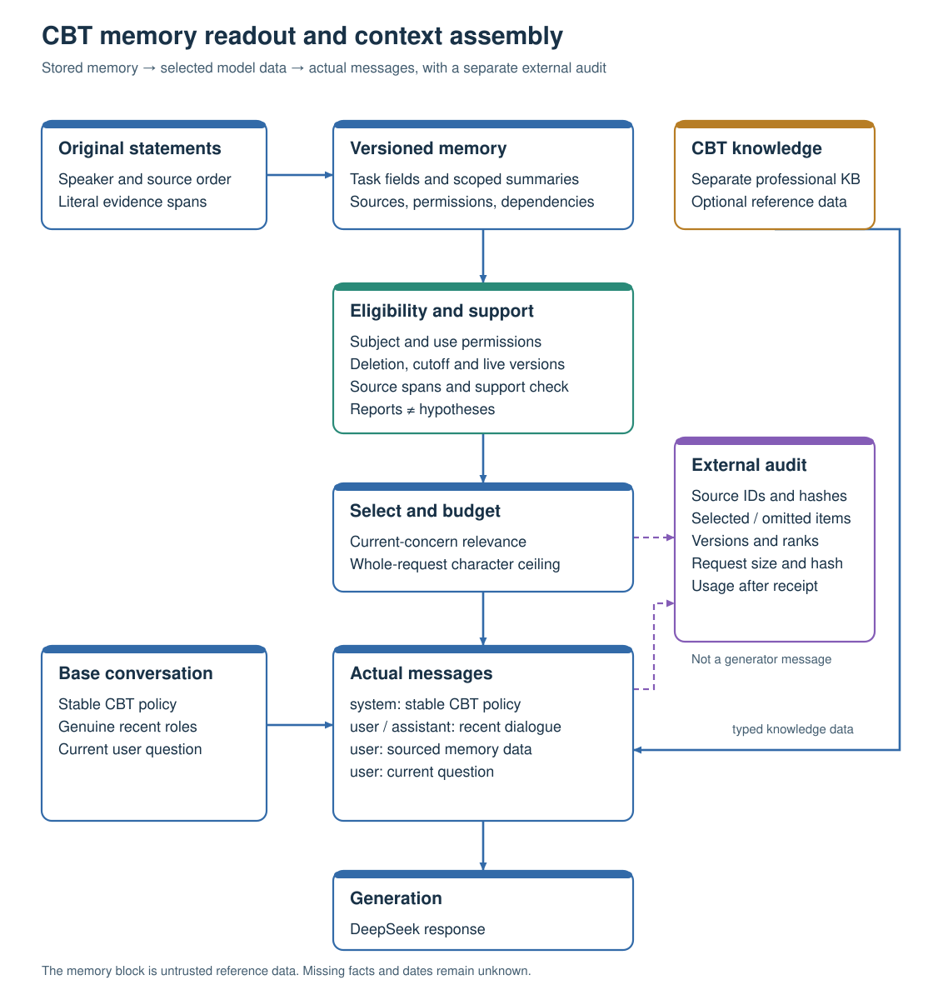
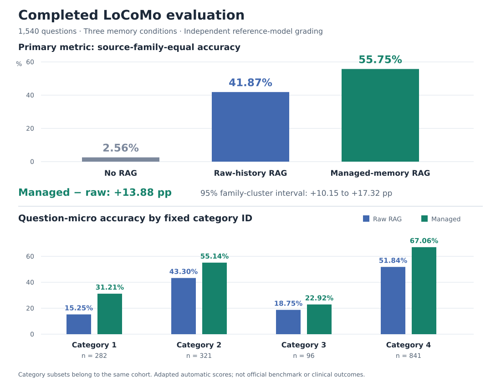

# CBT Memory System

Research prototype for **A Hierarchical Memory Framework for Psychotherapy Reflection and Care Tracking**.

The system connects source-supported personal memory to a CBT dialogue agent. It tracks goals, homework, changing self-reports and working formulations across sessions, while keeping professional CBT knowledge separate from personal history.

## Memory architecture

The system has two lanes.

- **Store and process** (after each turn): every message is saved verbatim with speaker and time; memory items are extracted, each citing the quote it came from, and checked; a lifecycle manager supersedes, updates, expires or deletes records. Memory is organised in layers: background profile, goals, emotion (stated vs. inferred from wording), task state and the agent's own hypotheses.
- **Read and respond** (every user turn): after a safety check, the context builder fills a sourced memory block in a fixed order — the original messages that raw retrieval would select (never dropped), pinned profile items, up to three linked messages, ranked processed items, and CBT knowledge cards from reviewed textbooks — under a 24,000-character request limit. Each quoted message appears once and items cite it by a short identifier.

The managed context therefore always contains the raw-retrieval arm's information plus the processed memory ([union layers](evaluation/cbt-memory-effect/architecture_union/README.md)). The CBT knowledge channel ([knowledge adapter](modules/agent-integration/knowledge_adapter_v2.py), [corpus](modules/cbt-knowledge-rag/README.md)) gives every evaluation arm identical cards, so it never explains a difference between arms.



| Layer | Responsibility | Code and specification |
| --- | --- | --- |
| Source and memory records | Preserve original statements, speaker/time attribution, support decisions, versions and use permissions | [Memory schema and lifecycle](docs/architecture.md#5-long-term-memory-rag) |
| Memory preparation | Extract candidates, check their literal evidence and separately assess semantic support; keep hypotheses distinguishable from reported facts | [Projection contract](modules/agent-integration/cbt_projection_contract.py) |
| Readout and selection | Apply ownership, permission, deletion, time, correction and version rules; rank relevant records and retain required dependencies | [CBT retrieval](modules/agent-integration/cbt_retrieval.py) |
| Context assembly | Place selected processed memory and key evidence into the actual outbound request, alongside the shared counselor policy and recent dialogue | [Context-v4 renderer](modules/agent-integration/cbt_context.py) |
| Request audit | Record included/omitted items, source and version mappings, complete request size/hash and returned provider usage outside the model context | [Readout specification](docs/context-assembly-v4/README.md) |

For the product and CBT-domain dialogue adapters, the message order is **fixed system policy → admitted recent user/assistant messages → an application-inserted user-role memory reference block → current user question**. The reference block is replaced each turn. General-memory benchmarks preserve recent historical reports as labelled reference data; the [path map](docs/context-assembly-v4/IMPLEMENTATION_PATHS.md) shows that adapter separately. A stored summary is not evidence that the generator received it: the final messages and their trace are inspected separately.

The [complete fictional request](docs/context-assembly-v4/FICTIONAL_REQUEST.md) is generated by the production renderer. It shows the source input, supported processed memory, every message role and the external audit trace. The [CBT counselor policy](docs/context-assembly-v4/counselor-policy.md) is shared across the three evaluation conditions.

Automatic capture and checking at the point of use keep the interaction light. A user can correct or delete a memory in ordinary conversation. Unsupported interpretations do not become confirmed personal facts; unresolved current state can prompt a relevant optional question. Silence is not confirmation.

## Completed evaluation highlight: LoCoMo

The new context-v4 comparison completed **1,540 questions across three conditions**. DeepSeek generated the answers; an independent Qwen model applied the frozen reference-grading method. The primary comparison is managed memory against capable raw-history RAG.

| Condition | Primary: source-family-equal accuracy | Secondary: question-micro accuracy |
| --- | ---: | ---: |
| No RAG | 2.56% | 2.34% |
| Raw-history RAG | 41.87% | 41.30% |
| **Managed-memory RAG** | **55.75%** | **55.26%** |

**Managed memory improved the primary metric by 13.88 percentage points over raw-history RAG**, with a 95% source-family bootstrap interval of **10.15–17.32 points**. It also scored higher in all four included question categories. The repeated-judgment label agreement was **99.35%**; this measures consistency, not correctness calibration.



The fixed denominator retains all 1,540 questions per condition, including four historical technical missing answers. All 5,078 planned grading entries were completed. These are adapted independent model-reference scores, not official benchmark scores, human ratings or clinical outcomes. This completed general-memory benchmark does not establish CBT response quality or treatment efficacy.

[Full LoCoMo methods, category breakdown and denominators](evaluation/architecture-rerun/results/locomo1540_completed_20261113.md) · [Exact aggregate values](evaluation/architecture-rerun/results/locomo1540_completed_20261113.json) · [Evaluation index](evaluation/README.md)

### MemoryAgentBench: 800-question evaluation

| Condition | Conflict-task accuracy |
| --- | ---: |
| Short-term history | 10/800 (1.25%) |
| Raw-history RAG | 419/800 (52.38%) |
| Managed-memory RAG | 480/800 (60.00%) |

The MAB conflict-task evaluation covers **800 questions per condition**. Managed memory improves accuracy over raw-history RAG by **7.625 percentage points**.

[Methods and full results](evaluation/objective-memory/results/full-20261105/README.md) · [MAB data policy](evaluation/selected-memory.json)

### CBT dialogue pilot (CACTUS)

On 28 synthetic CBT dialogues the model wrote the counsellor's next turn. Absolute 1–5 quality ratings were at the ceiling for every arm, so a blinded judge compared each managed answer with the raw-RAG answer in both orders. For "which answer uses the client's history better", the full managed configuration had a net win of **+0.42** (95% family-cluster interval 0.17–0.65) over raw-history RAG. This is an exploratory development-split result; a preregistered test-split run is planned. [Union run and judge](evaluation/cbt-memory-effect/architecture_union/README.md)

Each benchmark retains its own frozen protocol. Exact implementations, scoring rules and supporting records are documented with the corresponding experiment.

## Research scope

The research question is whether correctable, expirable and deletable memory improves cross-session tracking over retrieval from the same raw history. General-memory answering, memory-control software checks, CBT response quality and clinical benefit are separate endpoints.

- The current architecture has three evaluation conditions: `no_rag`, `raw_history_rag` and `managed_memory_rag`, with the same role policy, response model, admitted history and request ceiling.
- CBT-specific evaluations assess factual context, CBT method, next-step suitability, empathy and safety separately, with emphasis on factual context and next steps. These endpoints are interpreted separately from general-memory answering.
- Versioned runs, failed attempts and protocols are retained in their result directories. Each benchmark is reported with its own methods and denominator.
- The application is a research and educational prototype. A production clinical risk detector, referral service and clinical-outcome study have not been implemented.

## Repository and documentation

| Area | Entry point |
| --- | --- |
| Overall architecture and module diagrams | [docs/architecture.md](docs/architecture.md) |
| Memory readout, message format and design rationale | [docs/context-assembly-v4/README.md](docs/context-assembly-v4/README.md) |
| Shared CBT role and behavioral policy | [counselor-policy.md](docs/context-assembly-v4/counselor-policy.md) |
| Product dialogue and memory integration | [modules/agent-integration](modules/agent-integration/README.md) |
| Professional knowledge retrieval | [modules/cbt-knowledge-rag](modules/cbt-knowledge-rag/README.md) |
| Current three-arm replication protocols | [evaluation/architecture-rerun](evaluation/architecture-rerun/README.md) |
| All evaluation layers and experiment records | [evaluation](evaluation/README.md) |
| Fictional CLI and Colab application | [app](app/README.md) |

The [previous project overview and milestones](https://github.com/nanlalala/cbt-memory-system/blob/ea21751e17066aa768361313c08695251a31af0c/README.md) remain available at their frozen public revision.

## Development

```bash
python -m pip install -r requirements-test.lock
python -m unittest discover -s tests -v
python app/memory_demo.py --scripted
```

Models, full datasets and paid evaluations run only in genuine hosted Colab. The scripted demo uses fictional fixtures and performs no model call. Do not enter real patient information or use the prototype for clinical decisions.
