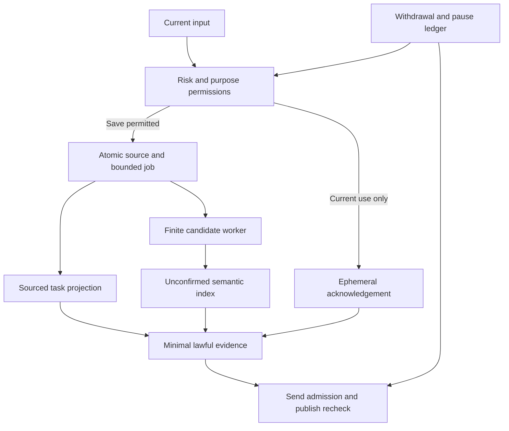
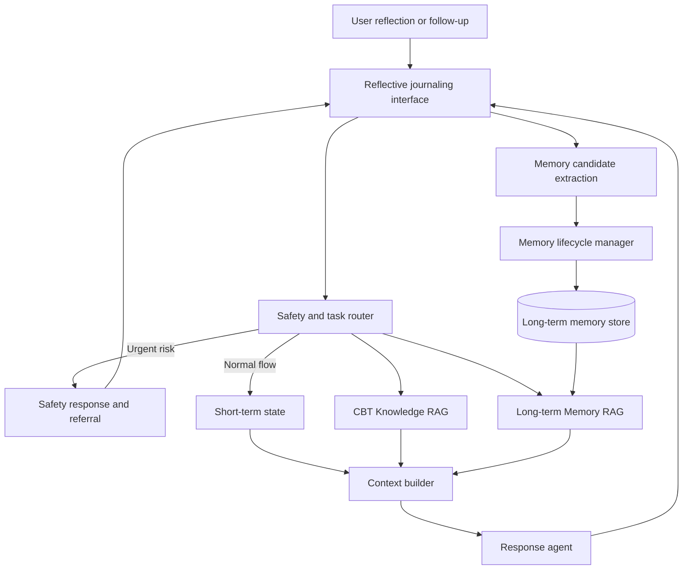

Research prototype for **A Hierarchical Memory Framework for Psychotherapy Reflection and Care Tracking**.

## Project overview

This project investigates how a CBT reflective-journaling agent can form, store, retrieve, update, correct and forget memories across repeated sessions. It is designed as a research and educational prototype, not as a diagnostic tool or a replacement for therapists.

The central research question is:

> Does correctable, expirable and deletable long-term memory support cross-session tracking more accurately than retrieval over the same raw conversation history?

Goals, homework and changing self-reports are the intended use cases. The current
implementation provides stronger evidence for reliable memory control than for
user benefit. Better CBT dialogue and treatment outcomes remain unestablished.

## Controlled memory v2

The new [controlled implementation](docs/cbt-memory-implementation-contract-v2.md)
adds source-first commits, separate retention/use/transmission permissions,
append-only multi-axis homework state, persistent bounded work and withdrawal
barriers. Semantic extraction remains an unconfirmed candidate; a matching quote
alone does not authorize a current fact. Historical and mutable content retain
the requested two roots with F1–F4 and V1–V5 subcategories.

Use the separate [controlled Colab notebook](app/Controlled_Memory_V2_Colab.ipynb).
It requires explicit approved cloud storage and stable user/run IDs, starts with
model calls disabled, and preserves the older notebooks and experiment identities.
The [9 November review repairs](docs/review-c757-remediation-20261109.md)
close the supplied deletion, task-polarity, replay-permission and evidence-boundary
counterexamples. The v2.1 replay also checks historical retrieval and the exact
final outbound evidence; it remains software verification only.

[Run the fictional engineering replay](app/README.md#controlled-memory-v2)
for observable state transitions without any model or network call. Its assertions
are software evidence, not a memory-benefit or CBT-outcome result.



## Overall architecture



The system uses two separate but coordinated retrieval channels:

- **CBT Knowledge RAG** retrieves professional CBT evidence, methods and safety guidance.
- **Long-term Memory RAG** retrieves relevant user-specific history, including emotions, goals, events, assignments, outcomes, cognitive patterns and corrections.

In the target architecture, deterministic safety routing runs before both retrieval channels. A production risk detector and referral workflow have not yet been implemented. Qualified knowledge and memory results are combined with the short-term session state by the context builder. Either retriever may return no context when its results are not sufficiently relevant.

The conversation also has a separate memory write path: supported information is extracted as a candidate, validated, versioned and managed through update, correction and forgetting rules before it becomes retrievable.

## Memory during a conversation

The default dialogue experience uses automatic history capture and
**checking at the point of use**, rather than asking the user to organize and
approve a list after every conversation. The strict review tools remain available.

| Available evidence | How it should be used |
| --- | --- |
| A source-verified user quotation | Refer to it as something the user said at that time; this does not prove it is still true |
| A changing goal, old preference or conflicting observation | Ask one relevant, optional question before relying on it as the current state |
| An unsupported model interpretation | Keep it out of factual context; a model's high confidence does not verify it |

For example, when discussing CBT practice: “You mentioned that thought records
sometimes made you more tense. Has that changed, or does the exercise still feel
burdensome?” The user can answer in ordinary conversation, correct the record or
move on. Silence is not confirmation. Questions should support the current task,
not become another checklist.

Evidence quality, freshness and conflicts are separate trust signals. Their
heuristics are not calibrated probabilities of truth. Automatic capture can be
turned off, and correction/deletion remain available. The first implementation
captures eligible quotations without an extra extraction-model call; it does
not silently validate semantic summaries or infer homework completion.

The repository's deterministic regression suite covers automatic
capture, historical/current-use separation, optional checks, source-tamper
rejection, opt-out handling and correction/deletion, plus source-bound study
capture, independent-review import and withdrawal-safe exports. These are software checks;
naturalness and reduced user effort still require a participant evaluation.

## Architecture components

| Component | Responsibility |
|---|---|
| Safety and task router | Detects urgent risk and decides whether knowledge or memory retrieval is required |
| Short-term memory | Maintains the recent conversation, current emotion, active goal, thought record and assignment |
| CBT Knowledge RAG | Retrieves grounded professional evidence and safety references |
| Long-term Memory RAG | Stores and retrieves user-specific, time-sensitive and correctable memories |
| Memory lifecycle manager | Handles consolidation, conflict, correction, superseding, expiry and deletion |
| Context builder | Validates, separates and budgets short-term state, personal memory and professional evidence |
| Response agent | Generates a supportive response while respecting safety and role boundaries |

See the [complete architecture document](docs/architecture.md) for the overall design and all module-level diagrams on one page.

## Repository structure

```text
cbt-memory-system/
├── docs/
│   └── architecture.md                 # Overall and module-level diagrams
├── modules/
│   ├── cbt-knowledge-rag/              # Professional knowledge and safety references
│   ├── long-term-memory/
│   │   ├── schema/                     # Typed memory records and metadata
│   │   ├── extraction/                 # Session-to-memory candidates
│   │   ├── storage/                    # User-scoped records and indexes
│   │   ├── retrieval/                  # Query, search, reranking and gating
│   │   └── lifecycle/                  # Update, correction, conflict and forgetting
│   └── agent-integration/              # Routing and context assembly
├── evaluation/
│   ├── knowledge-retrieval/
│   ├── memory-retrieval/
│   ├── end-to-end-dialogue/             # Frozen historical-QA experiment
│   ├── objective-memory/                # Public-gold comparison and control replay
│   └── safety/
└── app/                                # Colab dialogue/memory UI and synthetic CLI
```

## Experimental design

The completed [full objective comparison](evaluation/objective-memory/results/full-20261105/README.md)
compares **short-term history, raw-history RAG and managed memory RAG**. The main
contrast is managed memory versus raw-history retrieval;
giving an agent more history alone does not demonstrate the value of management.
Within each public dataset, the two RAG arms share the original source history,
response model, access eligibility and character budget. Knowledge and safety
conditions stay fixed. Lifecycle events are checked separately in software replay;
the public QA results do not establish natural update or deletion handling.

| Evidence | What will be reported | Current boundary |
| --- | --- | --- |
| Public tasks with released answers | Fixed official answer rules on MemoryAgentBench fact conflicts and PersonaMem-v1 choices | Full hosted run: 1,389 questions / 4,167 arm rows; MAB version view 480/800 versus raw 419/800; Persona RAG arms share identical inputs |
| Memory control through the full pipeline | Goals, homework, state, corrections, expiry, deletion and isolation | Strengthened v2 synthetic replay: both arms pass 26/26 queries and 56/56 operations, including relevance/body mutation checks; no user-benefit claim |
| User workflow | Four visits: set a goal, review homework, revise, consolidate/delete; completion, errors, time and review effort | Versioned collection/analysis tools and nonclinical feasibility protocol; zero participants |
| CBT process | Independent review of source fidelity, goals, homework review, guided discovery, action, progress and boundaries | Blank professional-review packets prepared for 32 archived knowledge-RAG replies; zero independent human ratings |
| Source-candidate CBT follow-ups | Actual chronological extraction, manager/store updates, retrieval and answers on 36 fictional development tasks | 108 answer rows; same-model draft criteria met on 18 short-term / 20 raw / 21 managed rows; extraction issues affect 24 managed prefixes; no stable CBT-benefit finding |
| Symptoms and functioning | Prospective outcomes and follow-up under a separately approved matched-comparator clinical study | No clinical participants or outcomes |

The executable [objective comparison](evaluation/objective-memory/README.md)
keeps official scoring answers out of preparation and generation. The hosted
PersonaMem census contains 589 questions but only 20 independent persona/context
groups. Current managed records preserve original quotations. The runner checks
whether raw-history and managed prompts are actually different; identical inputs
share one recorded response and cannot establish a management effect.
The earlier quotation-control RAG arms have identical inputs and are a control
baseline, not semantic-memory evidence. The separate v3.1 path adds a source-only
latest-version view for synthetic MAB facts, with the same closed-world prompt
and graph retrieval shared by raw and managed conditions. PersonaMem uses shared
lossless source spans; its two RAG arms remain quote controls. The full hosted
run finished all 800 MAB and 589 PersonaMem questions under frozen executable
`1511706b3a4b0ac71416998b5b4d752a13c4e313`.

| Dataset | Short-term | Raw-history RAG | Managed-memory RAG | Interpretation |
| --- | ---: | ---: | ---: | --- |
| MAB conflicts | 10/800 (1.25%) | 419/800 (52.38%) | 480/800 (60.00%) | Within-v3 version-view gain +7.625 percentage points; 68 wins, 725 ties, 7 losses; one conservative family, no estimable family-level interval |

These are exploratory public-task findings. MAB multi-hop accuracy remains
96/400 (24%) in the managed arm. Public QA causal error attribution still requires
independent evidence annotations: all 2,062 arm rows scored incorrect officially retain
`answer_incorrect_stage_unresolved`. Source-path observations and software replay
do not establish CBT semantic extraction, user benefit or clinical effectiveness.

The separate [CBT follow-up development run](docs/cbt-process-followup-results-20261105.md)
now includes actual answers and source-stage observations. Its 36 fictional cases
are three parameter variants of 12 tasks, not independent people. Five raw/managed
pairs share inputs; nine pairs remain unresolved. Among the 27 resolved pairs,
managed has two higher and one lower draft grade, with 24 ties. These same-model
assessments do not establish stable management benefit, professional CBT quality,
participant burden or clinical outcomes. All attempts and preprocessing costs
are retained; API success does not imply valid semantic extraction.

The [separate v4 retrieval repair](docs/objective-v4-repair-results-20261105.md)
completed 206 new changed-input calls and explicitly reused 2,194 unchanged old
logical responses. Its reconstructed MAB scores are 483/800 managed and 419/800
raw; the earlier full-run table above remains v3.1. The repair gained three
managed answers; raw gained two and lost two. Multi-hop remains 98/400. This
development reconstruction is not a new independent or contemporaneous full run.

Run the [objective comparison in hosted Colab](https://colab.research.google.com/github/nanlalala/cbt-memory-system/blob/main/evaluation/objective-memory/Objective_Memory_Comparison_Colab.ipynb).
The [notebook](evaluation/objective-memory/Objective_Memory_Comparison_Colab.ipynb)
pins its executable code revision; preparation and paid batches start disabled.
The [full v3.1 entry](evaluation/objective-memory/Objective_Memory_Full_V3_Colab.ipynb)
uses a new run root and the review-fixed executable. The
[review response](docs/review-response-20261105.md) records temporal-isolation,
source-version diagnostics, paid-response recovery, opt-out and UI draft fixes.
Old frozen results remain available under their original code and protocols.

The separate
[authorized Run-All Colab entry](https://colab.research.google.com/github/nanlalala/cbt-memory-system/blob/main/evaluation/objective-memory/Objective_Memory_Authorized_RunAll_Colab.ipynb)
ran this bounded experiment after access was authorized.
It restores the exact original exposure protocol/metadata and waits for generation
before final scoring. The completed run used 3,550 actual canonical calls,
8,777,083 reported tokens and no recorded API failures or missing usage fields.
Costs exclude the earlier pilots; no money total is inferred without verified
prices. The [recovery note](docs/cloud-execution-recovery.md) preserves the earlier
connection diagnosis; the final controlled archive and derived output were
transferred cloud-to-cloud with checksums, without using the user's computer.

The [current evidence checkpoint](docs/evidence-status-20261105.md) retains the
negative objective pilots alongside the completed full-run findings. The
[dialogue-benefit tools](evaluation/dialogue-benefit/README.md) implement a separate
[four-visit nonclinical protocol](docs/research-validation-protocol.md), with
source-bound independent scoring, participant denominators and revocable private
artifacts. Its 60 planned slots are not enrolled people. The
[CBT process/outcome review](docs/cbt-process-outcome-evidence.md) connects goals,
homework and skill learning to the stronger evidence needed for actual symptom
and functioning benefit; none of those human outcomes has been measured yet.

The [evaluation protocol](docs/validation-next.md) defines denominators, fair
baselines, stage-level attribution, costs and independent-history analysis. It
keeps software reliability, continuity accuracy and actual usefulness separate;
there is no self-designed overall score. The earlier frozen three-condition
historical-QA experiment is retained under its original protocol, not relabelled
as this new comparison.

## Current status

Memory Schema v1 and Memory Manager v1 are implemented, including provenance-aware extraction, SQLite storage, correction, conflict confirmation, expiry, deletion and user/sensitivity isolation. Model-extracted summaries remain unconfirmed candidates until a separately evidenced confirmation step. Lifecycle decisions and their audit events run in serialized transactions, stale correction targets are rejected, hard deletion remains final during concurrent expiry, and only one active version may occupy a memory slot. Long-term Memory RAG v1 and the Agent context builder provide relevance gating, temporal reranking, access filters, bounded personal/professional sections and accurate inclusion traces.

A Colab dialogue interface now connects the extraction contract, SQLite memory manager,
retriever and context builder. Its conversational mode automatically captures eligible
fictional user quotations and checks changing information when it becomes relevant.
Saved observations remain distinguishable from confirmed facts. Optional review mode
supports candidate revision, explicit confirmation, correction and deletion.
The default responder is an
offline software demonstration; an optional capped provider enables real model responses.
The small safety gate is a research safeguard, not a complete crisis service.
In the optional review panel, candidates can be revised before confirmation. The interface shows the actual
extraction window and warns before discarding unprocessed messages. Memory
references are readable and labeled as context supplied to the agent, not proof
of use. Deletion explains its chat-reset effect before a separate confirmation.

**Use hosted Colab for models, GPU work and full datasets.** The
[dialogue and frozen historical-QA notebook](app/Structured_Memory_Colab.ipynb)
and the [objective comparison notebook](evaluation/objective-memory/Objective_Memory_Comparison_Colab.ipynb)
have separate experiment directories and protocols. Production benchmark preparation and API adapters refuse ordinary local
execution. No local model download or personal-computer GPU is required.

The historical-QA notebook provides `verify → prepare → reader → judge → status/export`
for the full frozen v2 cohorts. Reader and judge run in explicit batches of at
most 60 calls, with checkpoint download controls and no automatic loop or Drive
mount. Exports retain raw audit artifacts and checksums; partial checkpoints are
not final results. The [next validation plan](docs/validation-next.md) separates
this historical-QA comparison from later CBT continuity and semantic-memory work.

The earlier historical-QA comparison uses its unchanged [frozen evaluation plan](evaluation/end-to-end-dialogue/formal_evaluation_plan.json):

- Complete eligible LoCoMo: **1,540 questions**, three conditions, **4,620 planned responses**.
- LongMemEval-S: **500 questions**, including 30 abstention questions, **1,500 planned responses**.
- Same response settings and empty CBT knowledge in every condition. Older user statements
  enter the real memory manager as unconfirmed candidates under a separate research policy;
  benchmark text is never treated as user consent. Verbatim candidates are a baseline;
  optional semantic extraction has its own source-only, frozen model artifact.
- Reference-based model-assisted correctness is that experiment's primary endpoint,
  not the overall project's outcome measure. Lexical overlap is
  diagnostic. Paired uncertainty is computed by independent history group, with failures
  retained in the denominator. LoCoMo has development exposure; LongMemEval exposure and
  shared histories must be audited before any independent-test claim. A large question count
  alone does not establish adequate evidence.

The sixth-review fixes separate correction evidence from ordinary chat, keep failed
operations out of the successful session, and report attempted model calls even when
no valid answer returns. Duplicate detection preserves signs and operators; repeated
text at another source turn remains a separate observation. Evaluation writers now
reserve one output directory exclusively across processes before reading attempt budgets.

**Evaluation version boundary:** structured-candidate preprocessing v2 preserves source
observations that v1 could discard. Its prompts and model-extraction artifacts must be
rebuilt in a new directory; old structured-candidate outputs cannot be relabelled or
continued as v2. Knowledge relevance v2 and page-aware chunking also require a new
corpus and evaluation. The seven legacy knowledge sources remain disabled, so no new
full-corpus knowledge score is claimed. Archived pilot results and the separately
verified turn-retrieval table below remain historical results of their recorded code.

Validation before the usability changes: **283 deterministic tests passed**, including
real two-process contention with a mocked provider, failed dialogue operations,
and synthetic PDF → evidence-card provenance checks. Both historical audit commands
still recompute their original published results. These checks use no paid API or
real model and do not establish improved dialogue quality.

The continuity/interface revision passes **307 deterministic tests**, including
candidate revision before confirmation, repeat-extraction protection, typed-slot
consistency, verified readable sources, window coverage and cancelable deletion.
These checks validate the software changes; the participant study and new
raw-history comparison are still pending.

The current v2 experiment is paused while the final evaluation is revised.
The [4 November execution checkpoint](evaluation/end-to-end-dialogue/colab_20261104_v2_progress.json)
records complete input preparation and all **1,500 retained, hash-verified
LongMemEval-S responses** (500 complete three-condition questions). The controller
is cancelled; zero reference-judge labels and no LoCoMo responses have been
produced. Raw responses are backed up, but no final correctness score or new
raw-history comparison is reported.
A [recovered older-run log](evaluation/end-to-end-dialogue/colab_20261102_legacy_log_note.md)
reports a completed v1 LoCoMo run, but its raw scoring archive is unavailable and
the logged numbers cannot yet be independently recomputed. The historical
20-question pilot below remains unchanged and is reported separately.

Earlier Week 4 work:

- Source registration separates public availability from reviewed reuse permission. The selected YAML, registry and complete chunk metadata are bound into a corpus manifest and checked at build, load and retrieval. The seven legacy pilot sources remain disabled until review and document pinning are complete.
- The historical raw-history three-arm runner prepares external benchmark questions without exposing released answers or gold evidence labels to the response model. Its first condition uses no history, the second a bounded latest-session window, and the third that same window plus retrieved older history. This raw-history QA experiment does not yet evaluate automatic structured-memory extraction or CBT therapy quality.
- The fixed-fixture CLI demo exercises candidate creation, explicit confirmation, current-version correction, retrieval and deletion on fictional fixtures. It uses no model or API and is a software demonstration, not an effectiveness result.
- CPU regression dependencies use a platform-specific wheel hash lock; CI actions use immutable commits. Dense/re-ranking models use fixed Hub commits and verified file bytes, with actual model/runtime identities in new caches and run manifests. The repo remains checkout-based rather than an installable Python package.

Regression checks cover the lifecycle, source/configuration, evidence metadata, model identity, caches and offline pilot audit. The LoCoMo release has been verified and the eligible **1,540 questions / 4,620 three-arm requests** prepared offline. The 446 adversarial distractor questions are excluded from ordinary answer scoring.

### 20-question history-QA pilot — 19 October 2026

A seeded sample spanning **20 questions and 9 conversations** completed all **60/60 responses**. All responses reported the same DeepSeek Flash model name, but that historical v1 protocol did not preapprove a provider alias. Its scores remain a legacy audit result, not a run validated under the new strict model-identity policy. CBT knowledge was empty throughout; retrieval used raw older dialogue turns rather than confirmed structured memories.

| History available | Mean lexical token-F1 proxy | Median API response time |
|---|---:|---:|
| None | 0.019 | 1.75 s |
| Latest-session window | 0.071 | 1.63 s |
| Same window + retrieved older history | **0.209** | 1.87 s |

Adding older-history retrieval to the short window increased the mean F1 proxy by **0.137**, with **16 higher / 2 tied / 2 lower** per-question proxy scores. This small-sample answer-overlap result is not an official LoCoMo score, accuracy rate or clinical outcome. Spot checks found correct short answers penalized for longer wording, and wrong dates receiving higher overlap; semantic correctness still needs reference-based review. API timing excludes retrieval and indexing; official evaluation and model-assisted judging have not run.

Download the [60 per-question score rows](evaluation/end-to-end-dialogue/pilot_20261019_scores.csv) or the [aggregate scores and fixed settings](evaluation/end-to-end-dialogue/pilot_20261019_summary.json). The CSV contains benchmark IDs, condition labels, proxy scores, API latency and reported token use. Commands and excluded failure rounds are on the [experiment page](evaluation/end-to-end-dialogue/README.md).

The [benchmark-only audit ZIP](evaluation/end-to-end-dialogue/pilot_20261019_audit.zip) preserves the actual protocol, prompts, references and responses, with LoCoMo attribution and CC BY-NC 4.0 terms. Its [audit manifest](evaluation/end-to-end-dialogue/pilot_20261019_audit.json) binds archive/member hashes, timestamps and execution code. Recompute raw answers → per-question scores → published aggregates offline:

```bash
python evaluation/end-to-end-dialogue/verify_pilot_audit.py
```

This verifies the archived scoring inputs and arithmetic; hashes do not prove provider authenticity, semantic correctness or clinical value. Future real-user data must remain access-controlled and must not be published through this benchmark-only release path.

The earlier retrieval comparison using released LoCoMo evidence annotations over 1,986 questions found that hybrid TF-IDF + multilingual E5 retrieval outperformed either component alone. Hybrid achieved Evidence Recall@5 = 0.520, Recall@10 = 0.598 and MRR@10 = 0.415, compared with 0.449, 0.528 and 0.359 for TF-IDF. These evidence-retrieval scores are separate from the answer-overlap proxies above.

Long-term memory retrieval results:

| Method | Recall@1 | Recall@5 | Recall@10 | MRR@10 |
|---|---:|---:|---:|---:|
| TF-IDF | 0.241 | 0.449 | 0.528 | 0.359 |
| Multilingual E5 | 0.255 | 0.459 | 0.543 | 0.381 |
| Hybrid | **0.280** | **0.520** | **0.598** | **0.415** |

On 21 October, all three retrieval backends were rerun on a **hosted Colab T4**
with the pinned E5 snapshot and verified model-file bytes. The results matched the
historical table. The [execution report](evaluation/memory-retrieval/colab_20261021_verification.json)
records the actual environment/model identities and both full-cohort manifests.
The [text-free audit ZIP](evaluation/memory-retrieval/colab_20261021_public_audit.zip)
contains all **5,958 question/backend rankings**, released evidence IDs and checksums;
it omits question text, dialogue and generated answers. Recompute the retrieval metrics
without loading a model or downloading the dataset:

```bash
python evaluation/memory-retrieval/verify_pinned_retrieval.py
```

Full input preparation also completed in Colab: LoCoMo has 1,540 eligible questions
in 10 conversations; LongMemEval-S has 500 questions and 30 abstention cases.
The prespecified conservative shared-history grouping connects all LongMemEval-S
questions through reused background sessions. Its 500 questions therefore cannot be
presented as 500 independent history groups. These preparations are not completed
response experiments or evidence that structured memory improves dialogue.

Historical knowledge-retrieval pilot results (not the newly governed corpus):

| Metric | Result |
|---|---:|
| Recall@5 | **0.80** |
| Recall@10 | **0.84** |
| MRR@10 | **0.583** |
| Safety Recall@5 | **1.00** |

An early eight-scenario pilot found nearly identical dialogue scores for no RAG (7.94/8) and Reference RAG v2 (7.88/8). In the later 16-scenario full-corpus comparison, hybrid-and-reranked RAG scored 11.69/12 versus 11.38/12 for no RAG, with six RAG wins, two no-RAG wins and eight ties. The observed difference remains modest, so CBT Knowledge RAG is treated as a reference layer for grounding, citations, professional boundaries and safety support rather than proof of general conversational improvement. These are model-assisted development signals, not human clinical ratings.

The full no-RAG versus RAG comparison will be repeated after Long-term Memory RAG and Agent integration are complete. The end-to-end evaluation will assess dialogue quality, cross-session continuity, assignment tracking, professional boundaries, safety, latency and token cost.

## Four-week implementation plan

| Week | Main goal | Key tasks | Deliverables |
|---|---|---|---|
| **Week 1 — complete** | Memory schema and data preparation | Define short- and long-term memory types; design schemas for emotions, events, goals, assignments, cognitive patterns and corrections; prepare multi-session test cases | Memory Schema v1, four structured examples and ten multi-session extraction cases |
| **Week 2 — core complete** | Memory writing and lifecycle management | Implement candidate extraction, validation, deduplication, conflict detection, updating, user correction, expiry and forgetting | Memory Manager v1, correction workflow and unit-test results |
| **Week 3 — core complete** | Long-term Memory RAG and Agent integration | Build user-scoped memory indexes; implement semantic retrieval, temporal reranking and relevance gating; integrate both RAG channels with short-term context | Long-term Memory RAG v1, dual-retrieval context builder, 40 tests and official LoCoMo comparison |
| **Week 4 — pilot complete; further evaluation pending** | Comparative evaluation and reporting | Freeze source policy; prepare three controlled memory conditions; run answer generation and scoring; verify the confirmation/correction/deletion demo | Source registry, evidence cards, Colab dialogue demo and full-cohort experiment code complete; full structured-candidate responses and reference-based scoring pending |

## Run the new work

```bash
python -m pip install -r requirements-test.lock
python -m unittest discover -s tests -v
python app/memory_demo.py --scripted
python app/memory_demo.py
```

The interactive demo only accepts the supplied fictional fixtures. Do not enter real patient information or use it for clinical decisions.

## Documentation

- [System architecture](docs/architecture.md)
- [Three-arm experiment: commands and limits](evaluation/end-to-end-dialogue/README.md)
- [Colab dialogue and memory demo](app/README.md)
- [Final evaluation: memory control, continuity and user value](docs/validation-next.md)
- [Source policy and evidence cards](modules/cbt-knowledge-rag/README.md)
- [Pinned development environment](docs/development.md)
- [CBT Knowledge RAG report](modules/cbt-knowledge-rag/CBT_RAG_v1_Report.md)
- [Full-corpus dialogue comparison](modules/cbt-knowledge-rag/CBT_RAG_v4_Full_Comparison.ipynb)
- [Limited-corpus recovery experiment](modules/cbt-knowledge-rag/CBT_RAG_v3_Expanded_Evaluation.md)
