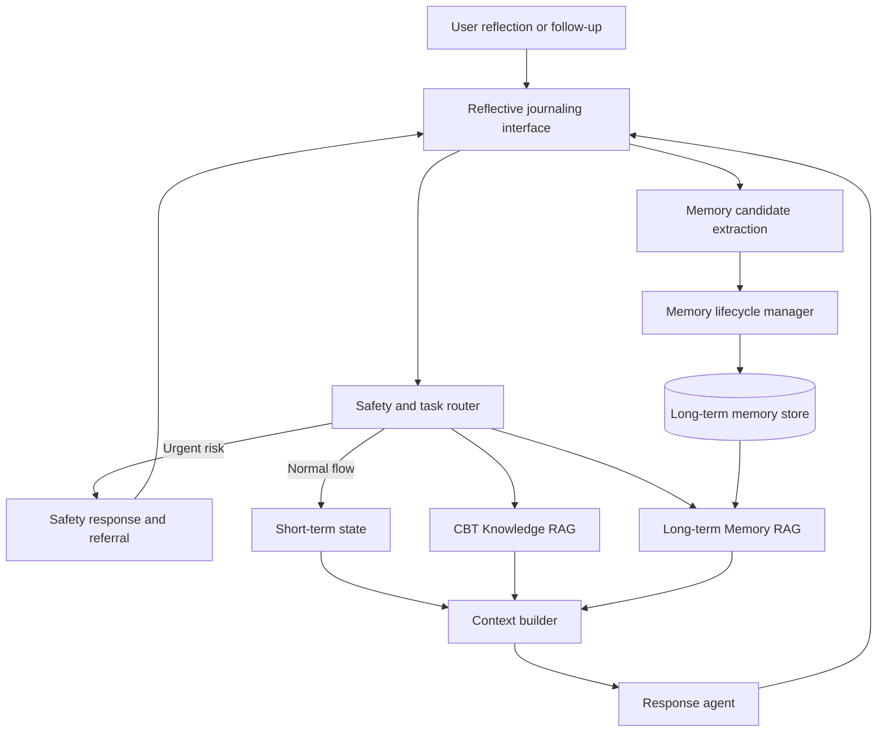

Research prototype for **A Hierarchical Memory Framework for Psychotherapy Reflection and Care Tracking**.

## Project overview

This project investigates how a CBT reflective-journaling agent can form, store, retrieve, update, correct and forget memories across repeated sessions. It is designed as a research and educational prototype, not as a diagnostic tool or a replacement for therapists.

The central research question is:

> How can an AI agent use short-term and long-term memory to maintain continuity, track CBT goals and assignments, respect user corrections, and remain safe across multiple sessions?

## Overall architecture



The system uses two separate but coordinated retrieval channels:

- **CBT Knowledge RAG** retrieves professional CBT evidence, methods and safety guidance.
- **Long-term Memory RAG** retrieves relevant user-specific history, including emotions, goals, events, assignments, outcomes, cognitive patterns and corrections.

In the target architecture, deterministic safety routing runs before both retrieval channels. A production risk detector and referral workflow have not yet been implemented. Qualified knowledge and memory results are combined with the short-term session state by the context builder. Either retriever may return no context when its results are not sufficiently relevant.

The conversation also has a separate memory write path: supported information is extracted as a candidate, validated, versioned and managed through update, correction and forgetting rules before it becomes retrievable.

## Architecture components

| Component | Responsibility |
|---|---|
| Safety and task router | Detects urgent risk and decides whether knowledge or memory retrieval is required |
| Short-term memory | Maintains the recent conversation, current emotion, active goal, thought record and assignment |
| CBT Knowledge RAG | Retrieves grounded professional evidence and safety references |
| Long-term Memory RAG | Stores and retrieves user-specific, time-sensitive and correctable memories |
| Memory lifecycle manager | Handles consolidation, conflict, correction, superseding, expiry and deletion |
| Context builder | Validates, separates and budgets short-term state, personal memory and professional evidence |
| Response agent | Generates a supportive response while respecting safety and role boundaries |

See the [complete architecture document](docs/architecture.md) for the overall design and all module-level diagrams on one page.

## Repository structure

```text
cbt-memory-system/
├── docs/
│   └── architecture.md                 # Overall and module-level diagrams
├── modules/
│   ├── cbt-knowledge-rag/              # Professional knowledge and safety references
│   ├── long-term-memory/
│   │   ├── schema/                     # Typed memory records and metadata
│   │   ├── extraction/                 # Session-to-memory candidates
│   │   ├── storage/                    # User-scoped records and indexes
│   │   ├── retrieval/                  # Query, search, reranking and gating
│   │   └── lifecycle/                  # Update, correction, conflict and forgetting
│   └── agent-integration/              # Routing and context assembly
├── evaluation/
│   ├── knowledge-retrieval/
│   ├── memory-retrieval/
│   ├── end-to-end-dialogue/
│   └── safety/
└── app/                                # Local synthetic lifecycle demo; journal UI planned
```

## Experimental design

The main comparison will include:

1. no cross-session memory;
2. short-term memory only;
3. short-term plus manageable long-term memory.

The response model, CBT Knowledge RAG, safety rules and evaluation scenarios will remain fixed across these conditions so that differences can be attributed to the memory framework.

## Current status

Memory Schema v1 and Memory Manager v1 are implemented, including provenance-aware extraction, SQLite storage, correction, conflict confirmation, expiry, deletion and user/sensitivity isolation. Model-extracted summaries remain unconfirmed candidates until a separately evidenced confirmation step. Lifecycle decisions and their audit events run in serialized transactions, stale correction targets are rejected, hard deletion remains final during concurrent expiry, and only one active version may occupy a memory slot. Long-term Memory RAG v1 and the Agent context builder provide relevance gating, temporal reranking, access filters, bounded personal/professional sections and accurate inclusion traces.

Week 4 implementation is underway:

- Source registration now separates public availability from reviewed reuse permission. New knowledge corpora require approved sources, pinned document bytes and traceable evidence cards. The seven legacy pilot sources are disabled for new runs until review and pinning are complete; the results below remain historical.
- The three-arm runner prepares external benchmark questions without exposing released answers or gold evidence labels to the response model. Its first condition uses no history, the second a bounded latest-session window, and the third that same window plus retrieved older history. This raw-history QA experiment does not yet evaluate automatic structured-memory extraction or CBT therapy quality.
- A local interactive demo exercises candidate creation, explicit confirmation, current-version correction, retrieval and deletion on fictional fixtures. It uses no model or API and is a software demonstration, not an effectiveness result.
- A pinned CPU test environment and GitHub Actions workflow support repeatable regression checks. The repo remains checkout-based rather than an installable Python package.

The regression suite now passes **77/77 tests**. The LoCoMo release has been verified and the eligible **1,540 questions / 4,620 three-arm requests** prepared offline. The 446 adversarial distractor questions are excluded from ordinary answer scoring.

### 20-question history-QA pilot — 19 October 2026

A seeded sample spanning **20 questions and 9 conversations** completed all **60/60 responses** with DeepSeek Flash. The three arms used the same response model and settings; CBT knowledge was empty throughout. Retrieval used a lexical baseline over raw older dialogue turns, not the confirmed structured-memory pipeline.

| History available | Mean lexical token-F1 proxy | Median API response time |
|---|---:|---:|
| None | 0.019 | 1.75 s |
| Latest-session window | 0.071 | 1.63 s |
| Same window + retrieved older history | **0.209** | 1.87 s |

Adding older-history retrieval to the short window increased the mean F1 proxy by **0.137**, with **16 higher / 2 tied / 2 lower** per-question proxy scores. This is an encouraging small-sample result for history-dependent question answering, not an official LoCoMo score, accuracy rate or clinical outcome. Lexical overlap is not accuracy: spot checks found correct short answers penalized when embedded in longer wording, and wrong dates receiving higher overlap; semantic correctness still needs reference-based review. API timing excludes retrieval and indexing; official evaluation and model-assisted judging have not run.

Reproduction settings, excluded provider-default failure rounds and the content-free aggregate are recorded directly in the [experiment page](evaluation/end-to-end-dialogue/README.md).

The earlier retrieval comparison using released LoCoMo evidence annotations over 1,986 questions found that hybrid TF-IDF + multilingual E5 retrieval outperformed either component alone. Hybrid achieved Evidence Recall@5 = 0.520, Recall@10 = 0.598 and MRR@10 = 0.415, compared with 0.449, 0.528 and 0.359 for TF-IDF. These evidence-retrieval scores are separate from the answer-overlap proxies above.

Long-term memory retrieval results:

| Method | Recall@1 | Recall@5 | Recall@10 | MRR@10 |
|---|---:|---:|---:|---:|
| TF-IDF | 0.241 | 0.449 | 0.528 | 0.359 |
| Multilingual E5 | 0.255 | 0.459 | 0.543 | 0.381 |
| Hybrid | **0.280** | **0.520** | **0.598** | **0.415** |

Historical knowledge-retrieval pilot results (not the newly governed corpus):

| Metric | Result |
|---|---:|
| Recall@5 | **0.80** |
| Recall@10 | **0.84** |
| MRR@10 | **0.583** |
| Safety Recall@5 | **1.00** |

An early eight-scenario pilot found nearly identical dialogue scores for no RAG (7.94/8) and Reference RAG v2 (7.88/8). In the later 16-scenario full-corpus comparison, hybrid-and-reranked RAG scored 11.69/12 versus 11.38/12 for no RAG, with six RAG wins, two no-RAG wins and eight ties. The observed difference remains modest, so CBT Knowledge RAG is treated as a reference layer for grounding, citations, professional boundaries and safety support rather than proof of general conversational improvement. These are model-assisted development signals, not human clinical ratings.

The full no-RAG versus RAG comparison will be repeated after Long-term Memory RAG and Agent integration are complete. The end-to-end evaluation will assess dialogue quality, cross-session continuity, assignment tracking, professional boundaries, safety, latency and token cost.

## Four-week implementation plan

| Week | Main goal | Key tasks | Deliverables |
|---|---|---|---|
| **Week 1 — complete** | Memory schema and data preparation | Define short- and long-term memory types; design schemas for emotions, events, goals, assignments, cognitive patterns and corrections; prepare multi-session test cases | Memory Schema v1, four structured examples and ten multi-session extraction cases |
| **Week 2 — core complete** | Memory writing and lifecycle management | Implement candidate extraction, validation, deduplication, conflict detection, updating, user correction, expiry and forgetting | Memory Manager v1, correction workflow and unit-test results |
| **Week 3 — core complete** | Long-term Memory RAG and Agent integration | Build user-scoped memory indexes; implement semantic retrieval, temporal reranking and relevance gating; integrate both RAG channels with short-term context | Long-term Memory RAG v1, dual-retrieval context builder, 40 tests and official LoCoMo comparison |
| **Week 4 — pilot complete; further evaluation pending** | Comparative evaluation and reporting | Freeze source policy; prepare three controlled memory conditions; run answer generation and scoring; verify the confirmation/correction/deletion demo | Source registry, evidence cards, local demo and 20-question raw-history pilot complete; full structured-memory comparison and official evaluation pending |

## Run the new work

```bash
python -m pip install -r requirements-test.lock
python -m unittest discover -s tests -v
python app/memory_demo.py --scripted
python app/memory_demo.py
```

The interactive demo only accepts the supplied fictional fixtures. Do not enter real patient information or use it for clinical decisions.

## Documentation

- [System architecture](docs/architecture.md)
- [Three-arm experiment: commands and limits](evaluation/end-to-end-dialogue/README.md)
- [Local memory demo](app/README.md)
- [Source policy and evidence cards](modules/cbt-knowledge-rag/README.md)
- [Pinned development environment](docs/development.md)
- [CBT Knowledge RAG report](modules/cbt-knowledge-rag/CBT_RAG_v1_Report.md)
- [Full-corpus dialogue comparison](modules/cbt-knowledge-rag/CBT_RAG_v4_Full_Comparison.ipynb)
- [Limited-corpus recovery experiment](modules/cbt-knowledge-rag/CBT_RAG_v3_Expanded_Evaluation.md)
