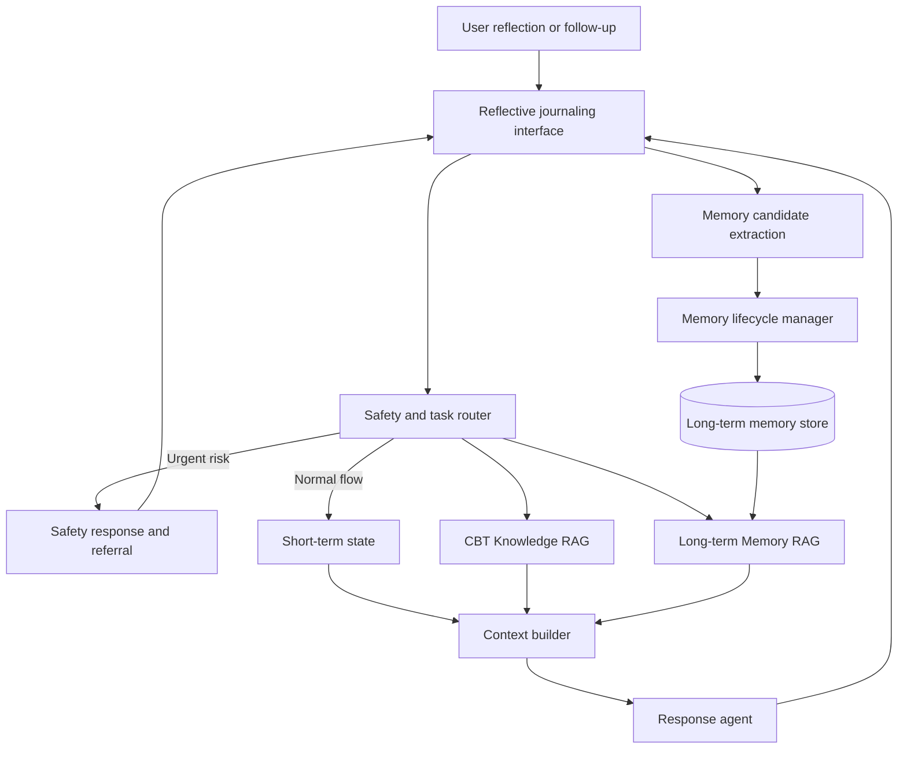
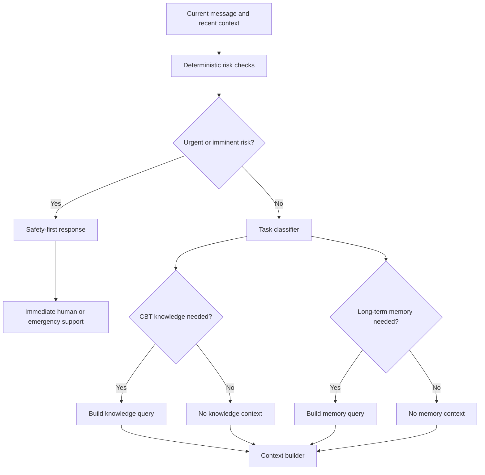
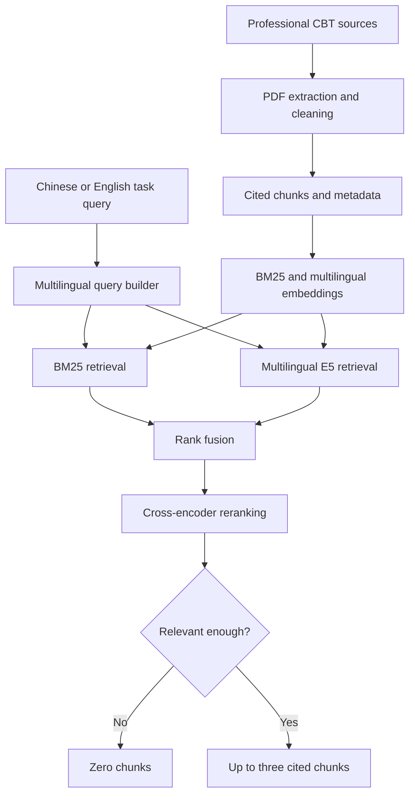
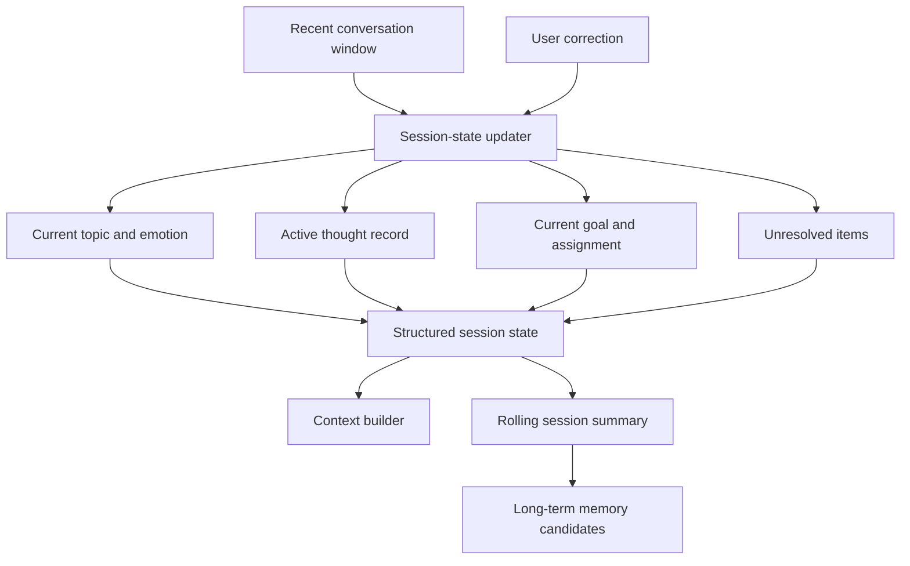
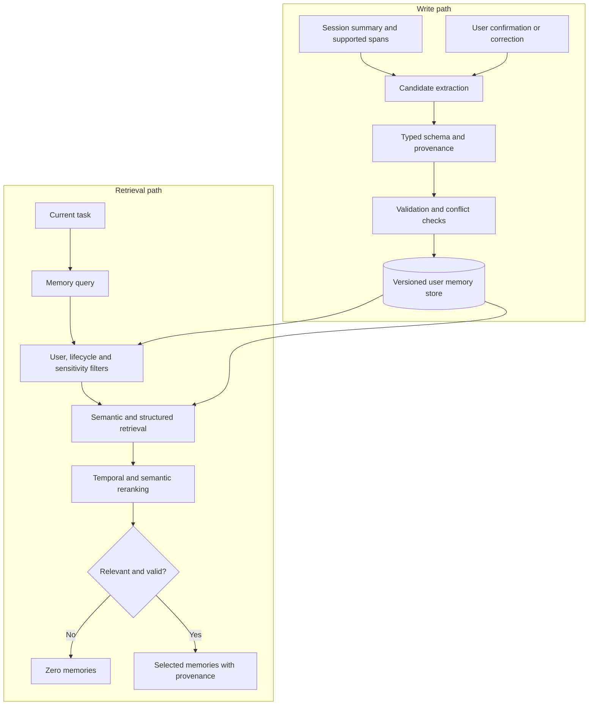
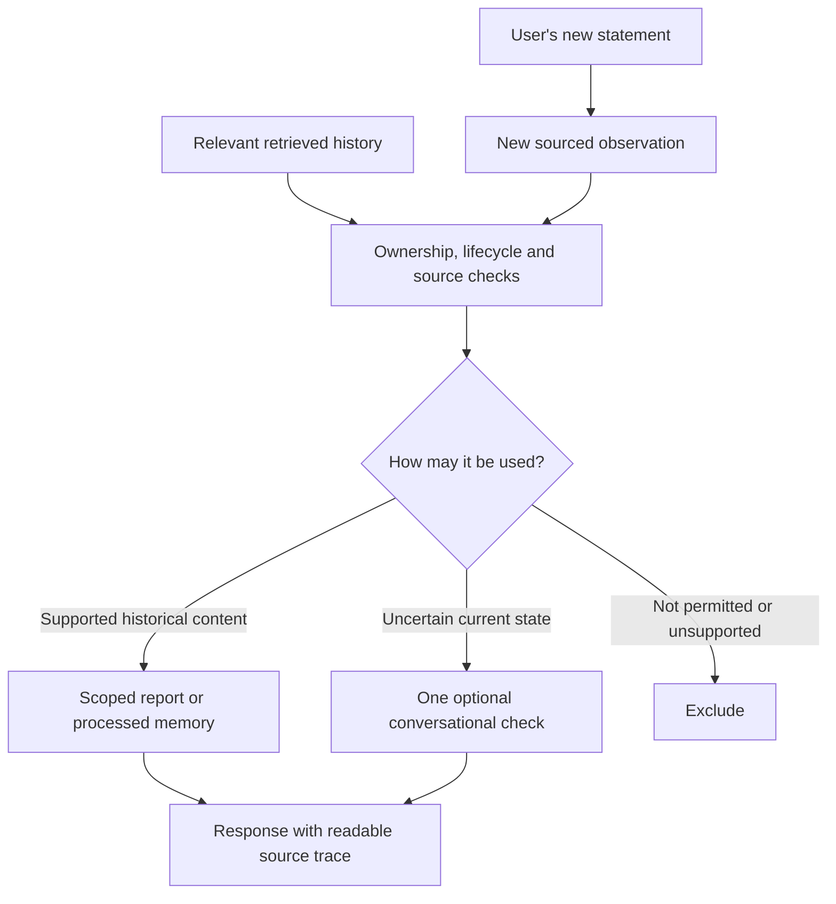
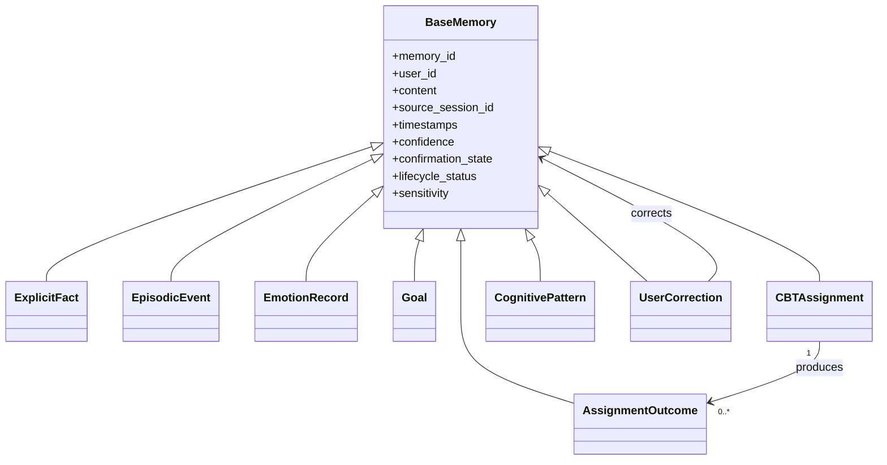
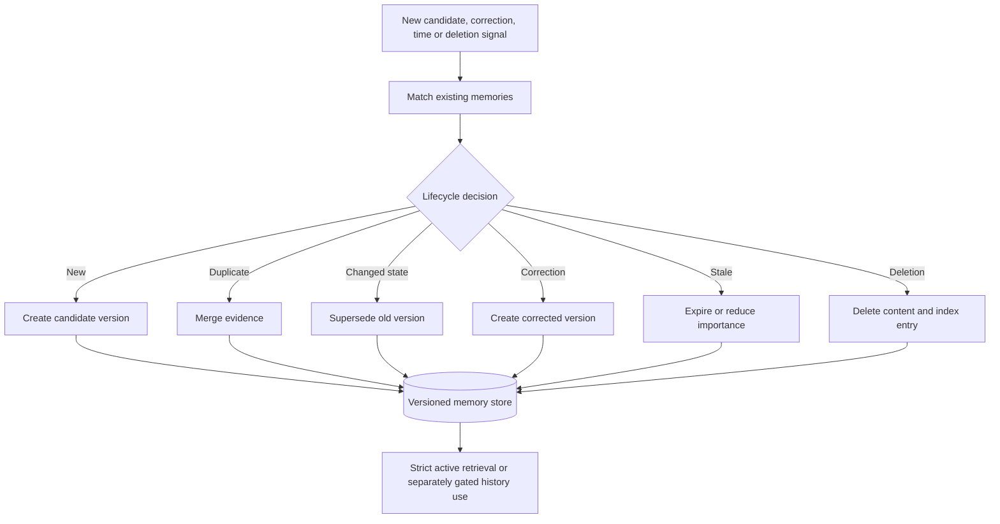
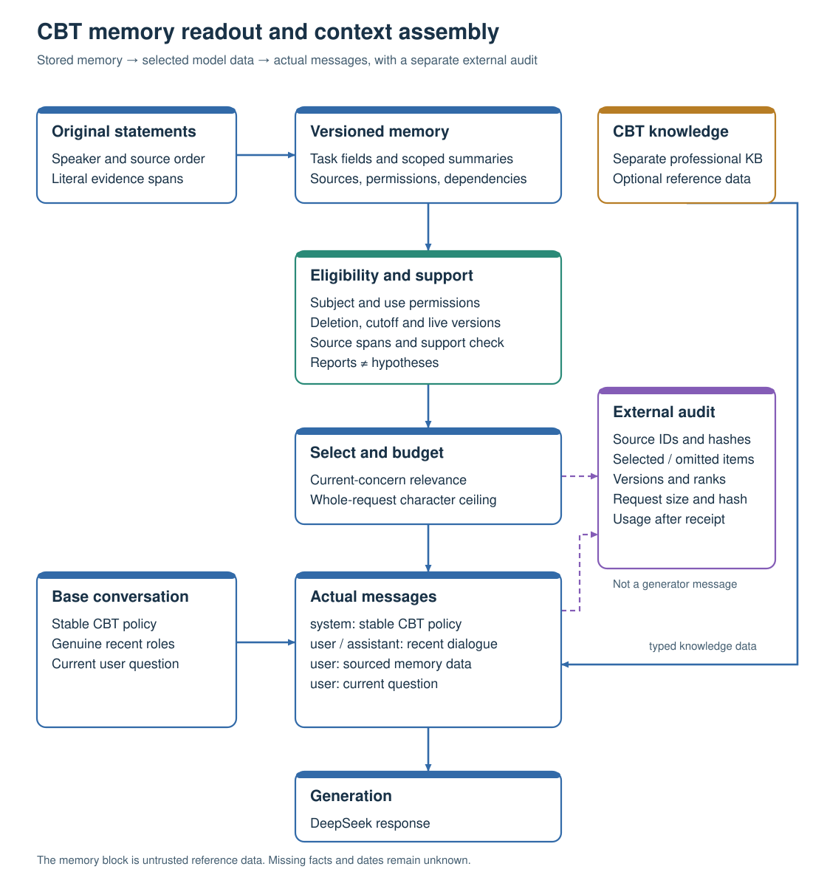
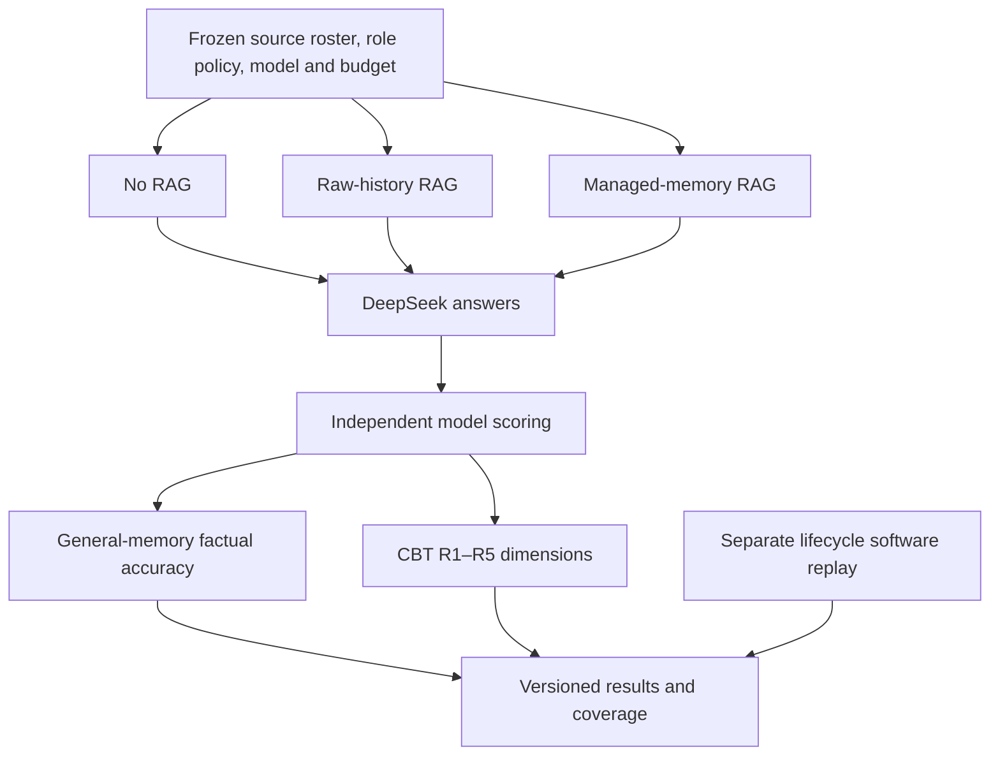

# System architecture

The implemented memory path includes source capture, typed task and contextual
projections, support checks, versioned retrieval and the context-v4 request
renderer. The research prototype includes fictional-data CLI and Colab dialogue
demonstrations. A production clinical risk detector, referral service,
authenticated journal UI and production privacy controls remain unimplemented.
Target application components are identified separately from the implemented
memory pipeline.

The current [readout implementation and complete request](context-assembly-v4/IMPLEMENTATION_PATHS.md)
make the storage-to-generator boundary explicit. Supported processed memory
actually enters the dynamic model context; the external audit trace is a separate
artifact. Earlier quote-only adapters retain their own versions.

[Back to project overview](../README.md)

This page contains the overall architecture and all module-level diagrams in one continuous document.

## 1. Overall application design

The target application combines current-session state with separate professional-knowledge and personal-memory retrieval channels. Implemented ownership, permission and lifecycle checks gate memory readout. The clinical risk/referral components in this overview remain a target service boundary.

## 2. Safety and task routing

Crisis detection is not delegated to vector retrieval. Either normal retrieval channel may return no context.

## 3. CBT Knowledge RAG

This channel provides professional evidence, role boundaries and safety references.

## 4. Short-term memory

Short-term memory represents what is active now. Only selected, supported information becomes a long-term memory candidate.

## 5. Long-term Memory RAG

The write path creates traceable, correctable memories. The read path retrieves only relevant, valid and permitted memories.

The current dialogue mode reads supported processed information as well as
source quotations. Literal evidence binding and a separate semantic-support
assessment qualify a processed item; neither establishes user endorsement or
independent truth. Proposals, task acceptance, reported participation and outcomes
retain separate axes. Working hypotheses remain explicitly unverified.

A source statement may be used as a report made at that time. Changing or
uncertain current information can prompt a relevant optional check, rather than
routine per-item confirmation. The versioned benchmark adapters preserve their
source-scope and ordinal-time restrictions.

Evidence quality, age and conflicts guide this decision. A model's confidence
number cannot override source or access checks. Automatic capture can be disabled;
management evidence is separated from chat, and a non-answer is not confirmation.

## 6. Memory schema

Every memory retains provenance, time, confidence, confirmation, lifecycle and sensitivity metadata. User statements remain distinguishable from model inferences.

## 7. Memory lifecycle

Updates preserve provenance. Superseded, expired, deleted or restricted memories
are excluded from ordinary context. Conversational history use is a separate,
source-checked policy and does not turn all candidates into retrievable facts.

## 8. Memory readout and actual context assembly

The implementation separates three objects:

| Object | Content and role |
| --- | --- |
| Stored source and memory records | Original statements, source scope, support decisions, task axes, versions and permissions |
| Per-turn dynamic memory | Relevant supported processing, permitted task state, changes and necessary evidence selected for the present question |
| External request trace | Included/omitted items, source/version dependencies, request size/hash and actual provider usage; outside model messages |

Read admission checks the subject, permissions, deletion/stopped use, source
cutoff, conflicts and versions. Ranking and complete-request packing retain
control-relevant dependencies. Personal history and professional CBT evidence
keep distinct fields.

The current product and CBT architecture retest share this message contract:

1. Fixed system policy with the full CBT counselor role and behavioral rules.
2. Admitted recent dialogue in its original user/assistant roles.
3. One application-inserted **user-role** sourced-memory reference block.
4. The current **user** question, once.

The dynamic block is rebuilt every turn. Its data label does not make retrieved
text safe or correct by itself, and external content gains no system-policy
authority. A real tool-result message requires its actual tool call.

The [full fictional request](context-assembly-v4/FICTIONAL_REQUEST.md) is generated
by the actual renderer. The [path map](context-assembly-v4/IMPLEMENTATION_PATHS.md)
also documents the older system-message claims adapter and the historical
raw-evidence evaluation path, so their evidence cannot be confused with this
processed-memory readout.

## 9. Evaluation framework

Within each current three-arm experiment, the primary comparator is capable
raw-history RAG. The recent dialogue window and role policy are shared; it is not
a fourth condition. The comparison evaluates the full managed pipeline rather
than isolating representation alone.

CBT-specific factual context, CBT method, next-step suitability, empathy and
safety remain separate automatic endpoints. General-memory results and software
checks do not establish treatment efficacy or human experience.

The [evaluation index](../evaluation/README.md) retains the methods, versioned
results, scoring scope and missingness. MAB and LoCoMo retain separate experiment
protocols, with exact implementations and scoring records linked to each result.
