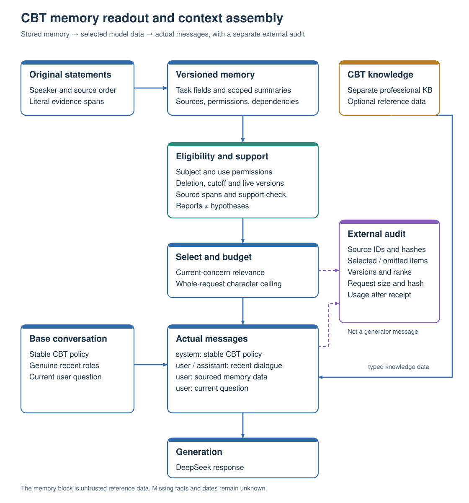

# From stored CBT memory to the actual model request

The active context-v4 path sends **supported processed content**, including task
fields, scoped summaries and explicitly marked working hypotheses. It does not
use a database summary as evidence that the generator saw that summary.

## Three records with different purposes

| Record | What it contains | Where it is used |
| --- | --- | --- |
| Stored memory and sources | Original speaker/text, source scope, permissions, projected task axes, object versions and support dependencies | Durable state and future readout |
| Dynamic memory block | Representation-specific `claims`, `action_plans`, raw `source_reports`, relevant formulation/progress/learning items and proposed `turn_guidance`, with source evidence | A newly assembled user-role reference message for this turn |
| External trace | Included/omitted identities and reasons, source hashes, versions, retrieval ranks, complete request size and hash; provider usage when available | Audit and reproducibility, outside the generator's messages |

The live product filters source ownership, use permissions, stopped/deleted
material, source cutoff and object versions before retrieval. Literal source
spans and a separate support check bind model-produced projections. Retrieval
ranks processed values for the present concern. Control-relevant fields such as
pauses and corrections retain their supporting dependencies and receive priority.
The builder packs complete claims and evidence under the **whole escaped request
character budget**, including policy, dialogue, metadata and output-cap fields.
A character ceiling is not an exact token count; provider token usage is recorded
after an actual receipt.

Support checking is not user confirmation. The renderer keeps original reports,
source-supported processing and agent hypotheses distinct. A proposed task is
not an agreed task; participation, target, reported count and learning remain
separate. Unreported benefit, dates, beliefs and emotion ratings remain unknown.
Routine per-memory user approval is not required.

## Actual role and ordering contract

`build_cbt_context` constructs:

1. Stable system policy, including the complete CBT counselor role.
2. Admitted recent messages in their genuine `user`/`assistant` roles.
3. One application-inserted **`user`** message beginning `SOURCED MEMORY DATA ONLY.`
4. The current **`user`** question, once.

The memory label is a data convention, not an instruction-safety guarantee.
Retrieved content and proposed turn guidance do not gain system-policy authority.
The application replaces this reference block each turn. A genuine tool result
requires a real corresponding tool call; this renderer does not invent one.

The [complete fictional request](FICTIONAL_REQUEST.md) and
[readable request JSON](fictional-request.json) show every actual message, rather
than a shortened schematic or database record. The linked
[serialized renderer request](fictional-request.wire.json),
[source input](fictional-input.json) and [external trace](fictional-trace.json)
close the source-to-context loop. The example is an offline software fixture;
its utterances and dates are explicitly invented, and it has no model answer or
effectiveness score. It shows an agreed target of two thought records, one
reported completion and a later pause. The pause is preserved without erasing
past participation or inventing improvement.

## Keep implementation paths separate

| Path | Actual representation and placement | Interpretation |
| --- | --- | --- |
| Current product: `ControlledDialogueSession` → `build_cbt_context` | Supported task claims and processed contextual items; memory is a user-role reference block after recent dialogue | Product readout, including actual version and permission dependencies |
| CBT architecture retest: `architecture_retest.runner.assemble` → `build_cbt_context` | Raw history or supported processed items, according to the three-arm condition; the same full CBT policy and message ordering | Domain evaluation adapter using its frozen source roster and endpoint |
| General-memory benchmarks: `formal_full.assemble` → `build_cbt_context` | Supported historical `case_state` reports plus key evidence, or raw source reports; the final user JSON carries the question and recent historical reports | LoCoMo/LongMemEval factual answering, with source-speaker attribution rather than replaying peer speakers as the live user/assistant |
| Earlier controlled replay: `evidence_bundles.build_outbound_messages` | Source-bound claims inserted as a separate system-role data message | Retained historical adapter; it is not the current context-v4 placement contract |
| Historical PR41 renderer: `auto_eval_v2.retrieval.render_request` | `[system, user]`, with `recent_messages`, `older_evidence` and `current_input` in the user JSON; evidence is original source wording | Index/selection evaluation; do not describe it as proof that processed summaries reached the generator |

The formal general-memory adapter has message roles `[system, user, user]`:
shared policy plus the factual-recall instruction; the dynamic sourced-memory
message; and user JSON containing `current_question`, `question_date` and
`recent_source_reports`. Its recent reports remain labelled benchmark references.
They are not injected as if the historical speakers were the current live user
and assistant. This differs from the genuine recent-turn handling of the product
and CBT-domain adapter while reusing the same renderer.

For released CBT material with only ordinal chronology, the architecture adapter
keeps the source order and labels processed content as historical reports at the
cutoff. It does not invent calendar dates, weeks or present-day task state. The
fictional dated product example is not an end-to-end demonstration of such
calendar-dependent claims on ordinal-only evaluation data.

## Code entry points

- [`cbt_context.py`](../../modules/agent-integration/cbt_context.py): source bindings, item eligibility, packing, roles and trace.
- [`controlled_dialogue.py`](../../modules/agent-integration/controlled_dialogue.py): task projection, current-version retrieval and real recent-turn admission.
- [`cbt_projection_contract.py`](../../modules/agent-integration/cbt_projection_contract.py): factual sections and hypothesis identity.
- [`architecture_retest/runner.py`](../../evaluation/cbt-memory-effect/architecture_retest/runner.py): domain source scope and the actual request adapter.
- [`formal_full.py`](../../evaluation/architecture-rerun/formal_full.py): general-memory reference attribution and the factual-recall request.
- [`render_example.py`](render_example.py): reproducible zero-model-call example.

The three comparison conditions remain **no RAG, raw-history RAG and managed
memory**. The managed-versus-raw comparison evaluates the complete pipeline;
it does not isolate a causal effect of representation alone.
