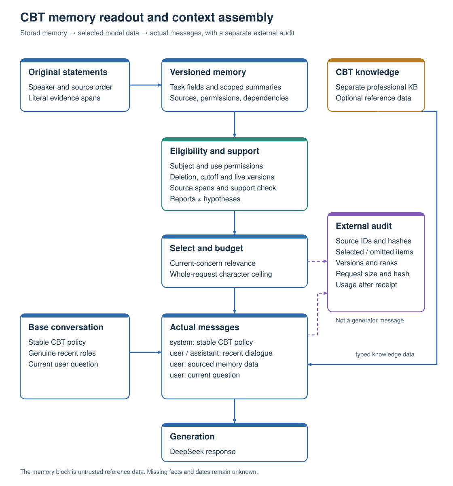

# CBT memory readout and context assembly

This revision connects the approved CBT readout design to the product request
builder and to separately frozen evaluation runs. The generator receives selected
processed information with its source basis. The request trace records the actual
messages and full request size, separately from stored memory.

The [implementation-path map](IMPLEMENTATION_PATHS.md) separates current product
and domain-evaluation requests from the older system-message bundle and raw-only
retrieval renderers. It also links the complete renderer-generated fictional
request, its source input, serialized wire and external trace.

## Information presented to the generator

| Section | Content | Qualification |
| --- | --- | --- |
| Case state | Relevant situations, original automatic thoughts, emotions, behavior and reported outcomes | Source-supported reports retain their original scope and unknown fields |
| Goals and action plans | Proposal, acceptance, participation, target, reported progress and experience | Task rules and evidence determine each field independently |
| Working formulation | Possible patterns, supporting episodes, contrary evidence and revisions | Agent hypotheses retain their inference identity and endorsement status |
| Conversation progress | Current focus, information already supplied, feedback and open follow-up | User feedback can change the next conversational move |
| Intervention and learning | Intended action, prediction, reported observation, obstacles and the user's own learning | Attempt counts do not establish learning or improvement |
| Turn guidance | A proposed response focus with its basis | Guidance is revisable planning data |

Empty sections can be omitted. Unknown ratings, dates and conclusions stay
unknown. User self-ratings, model estimates and independent evaluation scores
have separate meanings and provenance.

## Readout and message order

The application checks subject, permissions, deletion and stopped-use controls,
source cutoff, active version and conflicts before ranking candidates. A selected
correction, pause or task value retains the dependencies needed to interpret it.
Other candidates are chosen for the present question under the complete request
budget. Literal source offsets establish the quoted text. A separate support
check is required for model-generated paraphrases.

The new product path uses stable system policy, admitted recent user/assistant
messages, a user-role reference block inserted by the application, and the current
user question. The current question appears once. Retrieved text remains data.
The application replaces the reference block each turn. A tool result requires an
actual corresponding tool call.

The external trace retains source IDs and hashes, memory versions, selected and
omitted items, reasons, serialization size, request hash and provider usage.
Provider token usage is recorded after a receipt. Character budgets and token
budgets have different units.

## Versioned comparisons

The requested rerun has exactly three conditions: `no_rag`,
`raw_history_rag` and `managed_memory_rag`. All three share the complete
[CBT counselor policy](counselor-policy.md), admitted recent conversation,
question, model, sampling and complete request ceiling. No RAG supplies no
retrieved older memory. Raw RAG supplies selected original statements; managed
memory supplies supported processed content with necessary evidence. The primary
comparison measures the complete managed pipeline against capable raw-history
RAG. There are no additional representation-ablation conditions in this rerun.
Context placement and actual outbound requests are frozen. Existing experiment
directories preserve their original code and results.

The [fictional complete request](FICTIONAL_REQUEST.md) is generated by the real
renderer, with source input, request bytes and a separate audit trace. It is a
software illustration, not a clinical case or an effectiveness result.

The architecture rerun manifest identifies the original rosters. Released CBT
continuations, quotation recall, controlled care-tracking and general memory QA
are scored with their respective original endpoints. Independent automatic
R1–R5 assessment emphasizes factual context and appropriate next steps. Published
expert labels calibrate only the dimensions they actually annotate.

## Sources informing this design

Yinan Jin's undergraduate thesis, *基于检索增强的智能体记忆系统研究*,
section 5.2, separates background, retrieved memories, recent dialogue and query.
The CBT-specific fields and readout choices above are this project's design.

- CoCoA v1 separates basic and cognitive-distortion memory and constructs dynamic
  prompts for technique and stage selection.
  <https://arxiv.org/html/2402.17546v1>
- CCD-CBT's published method passes inferred conceptualization, current strategy
  and history to its generator. Its private simulated client profile is reserved
  for the client and evaluation.
  <https://aclanthology.org/2026.aacl-long.79.pdf>
- AutoCBT uses a counsellor with memory and requested supervisory feedback.
  <https://arxiv.org/html/2501.09426v1>
- HealMe emphasizes exploration of alternatives and the user's own understanding.
  <https://aclanthology.org/2024.acl-long.93.pdf>
- Socrates 2.0 reports feedback about repetitive questions and the need for
  personalized continuity.
  <https://mental.jmir.org/2025/1/e80461/>
- Beck's thought record distinguishes thoughts, emotion, adaptive response and
  reported outcome, including beliefs that may be true or partly true.
  <https://beckinstitute.org/wp-content/uploads/2021/08/Thought-Record-Worksheet.pdf>
- CCI's experiment worksheet records predictions, intended observations,
  actual outcomes and learning.
  <https://www.cci.health.wa.gov.au/~/media/CCI/Mental-Health-Professionals/Anxiety/Anxiety---Worksheets/Anxiety-Worksheet---10---Behavioural-experiment.pdf>

These sources support the design rationale. Effects of this implementation are
determined by the versioned runs and their individual receipts.

