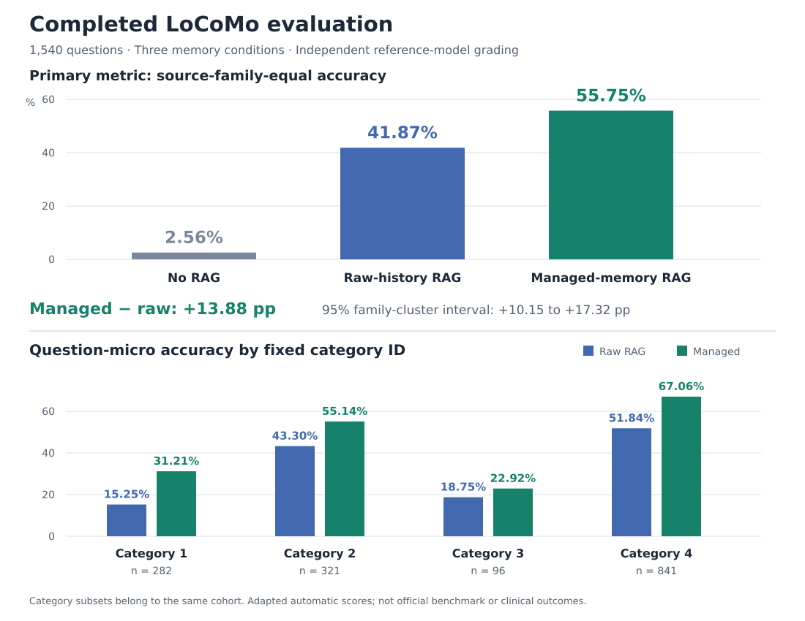

# Completed LoCoMo comparison: context v4

This is a **completed general-memory evaluation highlight**, using the original fixed 1,540-question LoCoMo roster (category IDs 1–4; category 5 excluded by that protocol) and three memory conditions. It evaluates factual answers across a conversational history; it does not evaluate CBT treatment outcomes.

## Primary comparison

| Condition | Source-family-equal accuracy | Question-micro accuracy | Correct question labels / fixed denominator |
| --- | ---: | ---: | ---: |
| No RAG | 2.56% | 2.34% | 36 / 1,540 |
| Raw-history RAG | 41.87% | 41.30% | 636 / 1,540 |
| **Managed-memory RAG** | **55.75%** | **55.26%** | **851 / 1,540** |

The predeclared primary metric gives equal weight to the **10 source conversation families**, then averages their within-family accuracies. Managed memory exceeds raw-history RAG by **13.88 percentage points**, with a **95% family-cluster bootstrap interval of 10.15–17.32 points**. Question-micro accuracy is the secondary metric: **55.26% versus 41.30%**, a gain of **13.96 points**.

## Breakdown by fixed question category

These are subsets of the same 1,540-question cohort, not four additional independent studies. Category numbers follow the frozen dataset records.

| Category ID | Questions per condition | No RAG | Raw-history RAG | Managed-memory RAG | Managed minus raw |
| --- | ---: | ---: | ---: | ---: | ---: |
| 1 | 282 | 10/282 (3.55%) | 43/282 (15.25%) | **88/282 (31.21%)** | **+15.96 pp** |
| 2 | 321 | 4/321 (1.25%) | 139/321 (43.30%) | **177/321 (55.14%)** | **+11.84 pp** |
| 3 | 96 | 3/96 (3.13%) | 18/96 (18.75%) | **22/96 (22.92%)** | **+4.17 pp** |
| 4 | 841 | 19/841 (2.26%) | 436/841 (51.84%) | **564/841 (67.06%)** | **+15.22 pp** |

Managed memory scored higher than raw-history RAG in all four included categories. The category rates use question-micro averaging and should not be substituted for the primary source-family metric.

## What was held fixed

- **Three conditions:** `no_rag`, `raw_history_rag`, `managed_memory_rag`.
- **Response model:** DeepSeek, with the same complete CBT counselor policy and factual-recall task instruction in all conditions. The benchmark instruction requests a direct factual answer rather than a CBT exercise.
- **Admitted information:** the same historical source roster and source-time boundary. Memory preparation does not receive the evaluation answer or question category.
- **Raw-history comparator:** BM25 plus pinned multilingual-E5 ranking over original source fragments, with whole-source packing and a maximum of 12 retrieved units. It is an active retrieval baseline.
- **Managed condition:** separately supported processed historical reports, ranked for the current question, with necessary evidence and historical-version dependencies. A later mention does not by itself establish supersession.
- **Shared budgets:** complete answer requests are capped at 24,000 serialized characters; the dynamic memory block is capped at 12,000 characters. The recent reference window admits up to 16 turns within 6,000 characters. These character limits are distinct from model token usage.
- **Evaluation:** an independent Qwen model uses the pinned adapted reference-grading templates. This is not the official LoCoMo evaluator/model score.

The actual response messages come from the shared [context-v4 renderer](../../../modules/agent-integration/cbt_context.py). Personal-history content remains an application-inserted reference block, with source attribution; it is not promoted to a system instruction.

## Completion and consistency

| Item | Completed result |
| --- | ---: |
| Fixed questions | 1,540 |
| Fixed primary answer denominator | 4,620 = 1,540 × 3 |
| Actual received answers | 4,616 |
| Historical technical missing answers retained as zero | 4 |
| Valid primary judge labels: no / raw / managed | 1,539 / 1,539 / 1,538 |
| Unparseable primary judge labels | 0 in each condition |
| Planned / completed grading entries, including repeats | 5,078 / 5,078 |
| Recorded grader API attempts | 5,040 |
| Valid repeated-judgment pairs | 462 / 462 |
| Repeated-label agreement | **459/462 (99.35%)** |

Exact request reuse can serve more than one logical grading entry, so grading entries and API attempts are different counts. The four historical missing answers remain in the 1,540-per-condition denominator: one no-RAG, one raw-history and two managed-memory rows. They were not resent or removed. No pending grades remain in this endpoint. Repeated-label agreement measures judge consistency, not agreement with an expert gold standard.

## Reproducibility and interpretation

The scientific runtime was pinned to commit [`7824a42`](https://github.com/nanlalala/cbt-memory-system/tree/7824a42f374df749e506006999f01109338836d4). The original [`formal_judge.summarize`](https://github.com/nanlalala/cbt-memory-system/blob/7824a42f374df749e506006999f01109338836d4/evaluation/architecture-rerun/formal_judge.py) was re-executed to validate the complete provider-receipt bindings, strict parsed labels, fixed denominator and completed grading roster. Confidence intervals use the original seed and 10,000 family-level bootstrap resamples.

[Exact public aggregate values](locomo1540_completed_20261113.json) retain unrounded scores, category counts and missingness. Versioned records and protocols remain in the [evaluation index](../../README.md). MAB has its own documented experiment protocol and implementation references.

The result supports improved cross-session factual answering in this fixed, development-exposed benchmark. It is exploratory evidence from 10 conversation families, not a confirmatory study, human experience measure, CBT response-quality result or clinical efficacy claim. CBT-specific factual-context and next-step assessments are separate endpoints.
